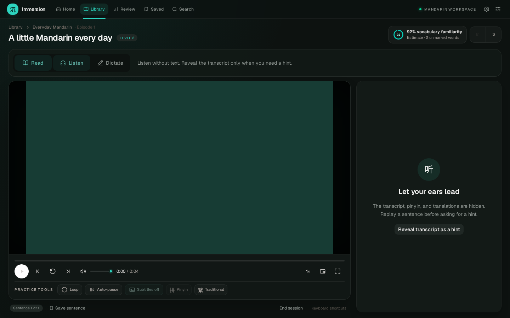
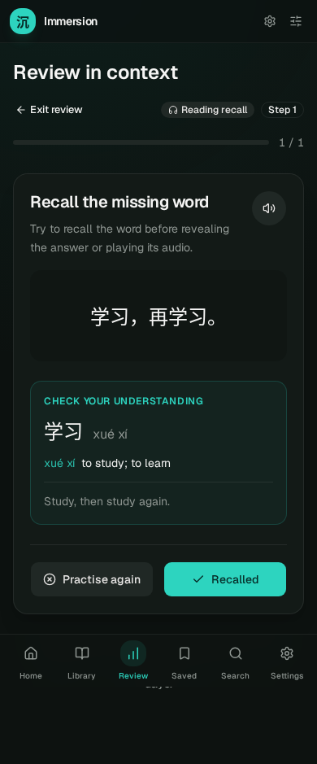
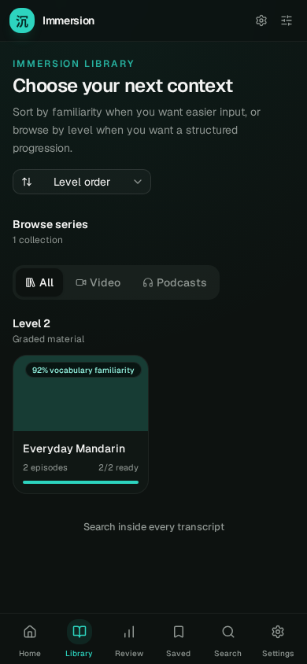

# Interface inspection and validation

The first interface changes make study intent explicit and feedback recoverable while keeping the existing React, Tailwind, and Radix design system. This review covers the application's route components, player surfaces, shared styles, keyboard handling, data-query states, and answer visibility.

## Inspection scope

The source inspection covers Home, Library/Series, Watch, Review, Saved/Export, Search, Word, Settings, Admin, and shared navigation/dialog/player controls. Runtime inspection used the actual production-built React application in Chromium with synthetic local video/audio and intercepted API fixtures. It covered desktop and mobile layouts, keyboard behaviour, retry flows, and automated contrast/accessibility checks. Personal media, Safari/iPad, manual screen-reader behaviour, and real-library GPU performance remain separate validation tasks.

## Route findings and changes

| Surface | Finding | First implementation | Remaining inspection |
| --- | --- | --- | --- |
| Navigation | No skip link; utility actions are small; route errors can retain focus unpredictably | Skip-to-content target and shared focus outlines | Keyboard route focus announcements and error-boundary reset across routes |
| Home | Activity presented as comprehensible input; coverage used as comprehension guidance | More precise familiarity/activity copy | Real content density, onboarding, chart accessible alternative, query failure combinations |
| Library/Series | Coverage obscures evidence source; readiness and availability can be confusing | Named sorting controls, semantic filter groups, accessible readiness/playback progress, and clearer vocabulary-familiarity labels | Large libraries, filters/search, missing media, clear processing versus playable state |
| Watch | Learning actions mix task choice and display preferences; subtitles-off leaves transcript visible | Labelled Read/Listen/Dictate selector, task explanation, explicit transcript hint; preserve preferences | Real video/audio, desktop/mobile/zoom/fullscreen, caption contrast over changing frames |
| Watch controls | Toggle state absent from assistive technology; dense short targets | aria-pressed for loop/pause/pinyin/script; focus outlines; 44px coarse-pointer learning actions | Volume/progress keyboard operation, short landscape layout, PiP subtitle limitations |
| Dictation | Audio-only entry; overlay leaks answers; inputs lack explicit labels; repeated work on render | Video support, overlay suppression, input labels, bounded input, cached scoring and debounced persistence | Long-transcript virtualisation, scroll/focus during playback, storage-unavailable behaviour |
| Review | Missing definitions; auto-spoken cloze; repeated target leaks; no save pending/error state | Full dictionary feedback, all-target masking, no pre-answer word audio, frozen session queue, guarded grades, retry/reload, honest summary | Network interruption during submission, autoplay denial, screen-reader feedback and focus between cards |
| Gloss | Custom modal has initial focus but no complete trap/restore contract | Radix Dialog provides focus trapping, Escape dismissal, and focus restoration while preserving the fullscreen portal and Space-to-resume workflow | Manual screen-reader and fullscreen device checks |
| Saved/Export | Personal note schema; graduates can disappear from daily practice | Correct dashboard waiting count; effective timing for clips | Configurable schema, interrupted export and duplicates, persistent export inbox |
| Search | Search failure can look like an empty initial screen; unsupported query punctuation | Named query input, explicit retry/error state, literal query parsing | Marked/numbered pinyin, traditional-source backfill, long results and focus order |
| Word | First dictionary reading may be wrong in context; traditional preference incomplete | Preserve alternatives; roadmap identifies contextual reading work | Both scripts, component examples, meaningful stroke interaction and missing-data fallback |
| Settings/Admin | Mixed capability assumptions; core versus remote features not sufficiently clear | Keep existing configuration; roadmap specifies capability/preflight and CPU/GPU work | Missing models/ffmpeg/Anki, offline explanations, safe backup and recovery |

## UI standards

Use semantic native controls or established Radix primitives with explicit names, state, focus behaviour, and keyboard support. Retain the user's Pleco tone palette; use labels and structure rather than colour alone for learning state. Preserve legible Chinese text with generous line height and controlled measure. Prefer a single clear primary action per task, accurate progress, recoverable errors, and no destructive reset without an appropriate recovery path.

Target WCAG 2.2 AA. A 44px touch target is the preferred ergonomic target for main controls, rather than a blanket assertion about every inline dictionary token. Verify custom word hit areas do not overlap into ambiguous adjacent targets. Reduced motion must include transitions as well as animations. Source-video burned-in text cannot be hidden by the app and must not be mistaken for an application answer-visibility defect.

## Validation record

The implementation branch contains meaningful regression coverage for scoring, task visibility, repeated cloze targets, event acknowledgement/retries, spaced review, cache/index updates, and timing. The final run on 18 October 2026 passed 105 backend tests, 25 frontend unit tests, 26 Chromium browser checks, and the TypeScript/Vite production build. Changed Python files pass Ruff core correctness checks (E4/E7/E9/F); repository-wide broader lint has pre-existing diagnostics outside this change. Backend tests emit an existing Starlette/httpx deprecation warning.

Browser checks include all nine main page accessibility scans plus an open dictionary-dialog scan with no violations under the selected WCAG A/AA tags, repeated-target masking, safe grade retries, audio/video task modes, keyboard focus restoration, four Watch viewport widths, and mobile layouts on eight other routes. These automated results do not certify complete WCAG conformance.

Optional Chinese font stylesheets now load only when selected. The initial CSS build output fell from approximately 350.8 kB to 110.3 kB, about 69% smaller. This measures stylesheet output, not total page load time. Real media playback/transcription, Anki Desktop export, Safari, 200% zoom, and manual assistive-technology testing still need their release gates.

## Browser acceptance matrix

- Viewports: 320px, 390px, 768px, 1440px; 200% zoom; short landscape; fullscreen.
- Routes: empty and populated Home/Library; Watch video/audio in each mode; Review with/without source/definition; Search results/error; Saved export preflight; Settings/Admin missing dependencies.
- Input: keyboard-only navigation, Chinese IME Enter, pointer/touch, reduced motion; focus visible and restored after dialogs.
- Failures: offline event flush, HTTP 503, refused beacon, failed playback, missing transcript, concurrent review, ambiguous network response, quota-limited local storage.
- Learning: no app-controlled text in an unassisted attempt; deliberate hints labelled; dictionary alternatives not asserted as a selected contextual meaning; activity not asserted as comprehension.

## Reviewed screenshots

These are real application screenshots using synthetic test media and fixture learning data, not a separate design mock-up.







## Reproduce the checks

```sh
cd web
npm ci
npx playwright install chromium
npm test
npm run build
npm run test:ui
```

From `server/`, run `uv run pytest` with Python 3.12 and the development dependencies installed. The browser tests intercept API calls, so they exercise production UI behaviour deterministically; the backend suite separately exercises the actual SQLite/API logic. The included tiny MP4 is a generated colour-and-tone fixture with no personal or third-party media.

No database schema migration is introduced in this delivery. Existing graduated items are preserved; the revised due/spacing policy applies to subsequent submissions. Full script-equivalent dictation, contextual pronunciation, and sense-specific knowledge remain explicitly scheduled in the roadmap.
